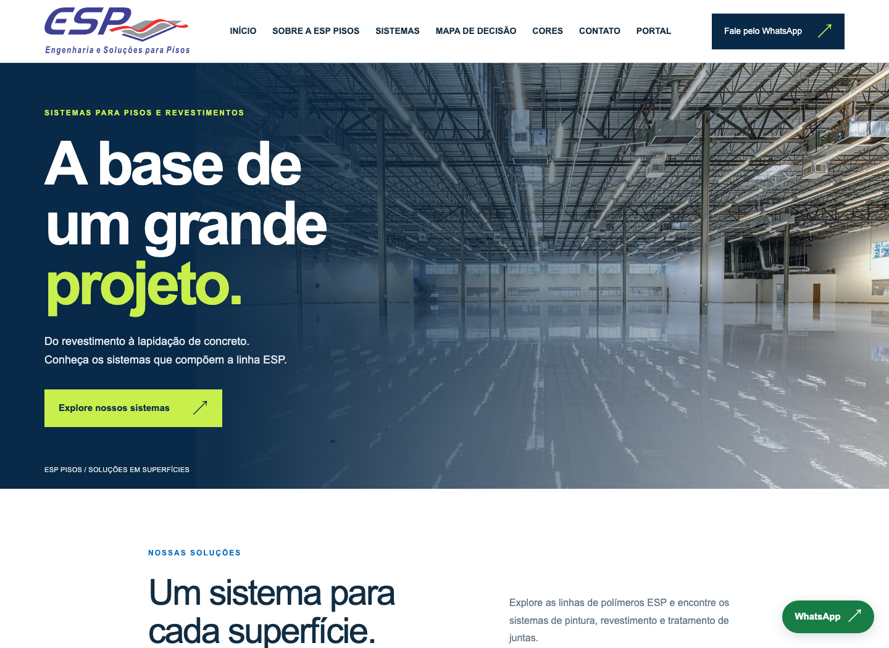
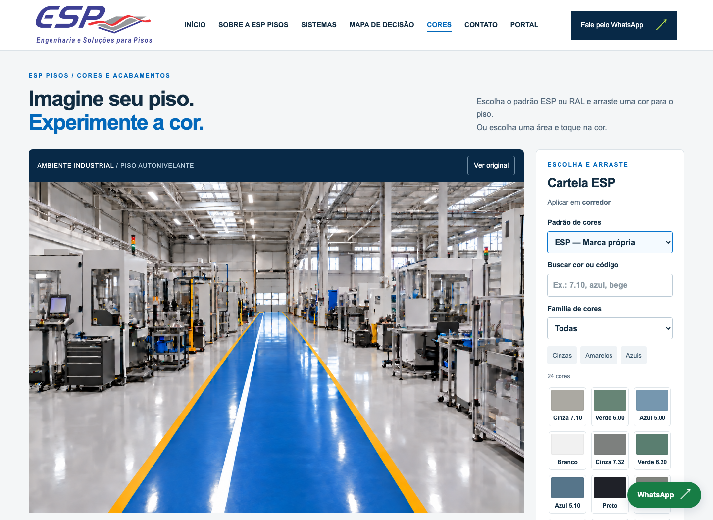
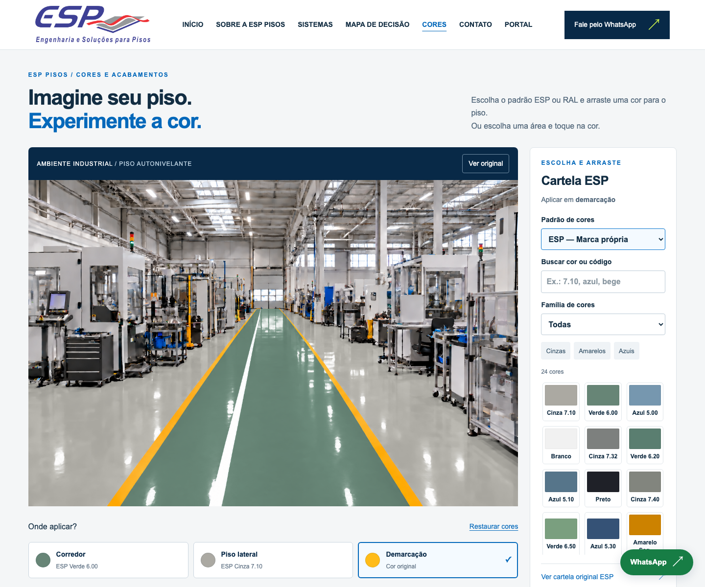
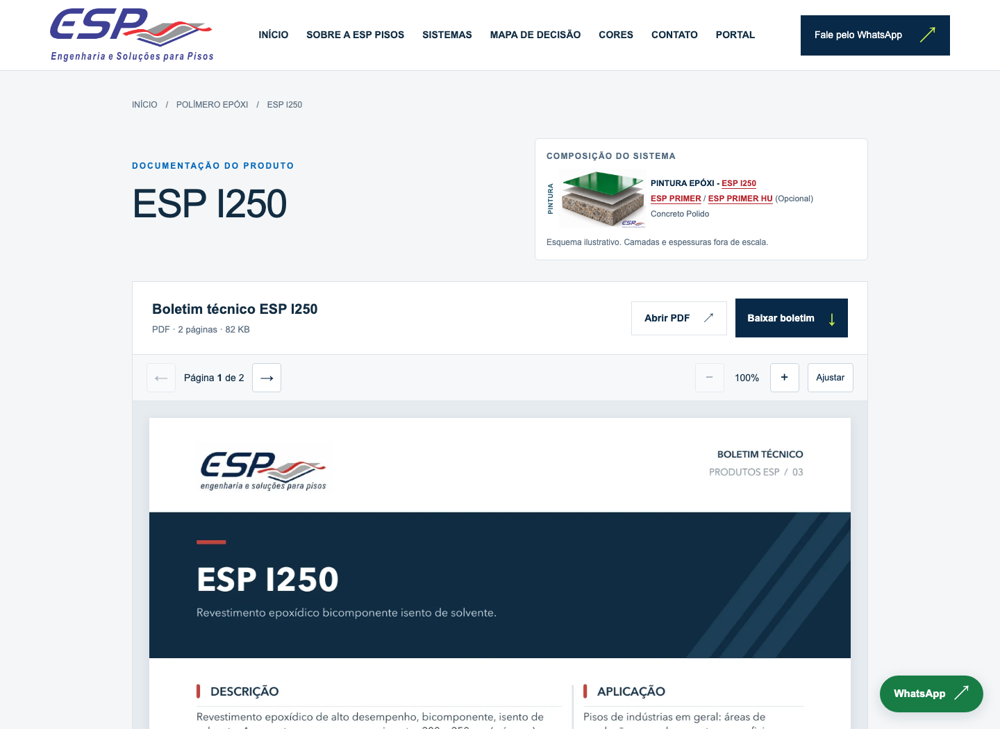

# ESP Pisos | Portfólio

Desenvolvi o site da ESP Pisos usando bastante o Codex e trabalhando também pelo VS Code. Foi uma forma de transformar o que eu conheço da rotina da empresa em ferramentas que o cliente e a equipe conseguem usar.

Os boletins técnicos foram elaborados por mim, originalmente sem IA. Depois, usei IA no desenvolvimento do site e para melhorar a apresentação desse material. Aqui dá para ver um pouco desse trabalho.

**[Acessar o site →](https://www.esp-pisos.com.br/)**

O site reúne os sistemas de pisos e revestimentos, com as linhas de epóxi, uretano, PU, MMA e lapidação de concreto. A ideia é facilitar a consulta antes mesmo da conversa comercial.

## Escolher a cor e ver no ambiente

O cliente pode escolher cores diferentes para o corredor, o piso lateral e a demarcação. Tem cartelas ESP e RAL, busca por nome ou código e filtros por família de cores.

Essa é uma combinação feita no próprio simulador. Dá para testar outras cores e voltar à imagem original. A simulação ajuda a visualizar a ideia; a confirmação da cor continua sendo feita com uma amostra física.

[Experimentar as cores →](https://www.esp-pisos.com.br/cores/)

## Ajudar na escolha do sistema

Nem todo cliente chega sabendo qual revestimento precisa. O mapa de decisão organiza essa conversa em seis etapas, considerando o uso do ambiente, os esforços sobre o piso, o acabamento e as condições da base.

Ele serve como orientação inicial para avaliar as opções com a equipe técnica.

[Conhecer o mapa de decisão →](https://www.esp-pisos.com.br/mapa-de-decisao/)

## O material técnico também faz parte do projeto

Os boletins que elaborei podem ser consultados no site, com navegação entre páginas, zoom e download em PDF. As páginas também mostram a composição dos sistemas em camadas, ligando a explicação visual à documentação do produto.

[Ver um boletim no site →](https://www.esp-pisos.com.br/produtos/esp-i250/)

## Um portal para a equipe

Também desenvolvi uma área com login para a equipe, com perfis como vendedor, administrador e RH, e recursos para preparar projetos e orçamentos. Essa parte está ligada à rotina interna da empresa.

Aqui mostro somente a tela de entrada. As telas internas, os dados dos clientes e os orçamentos não fazem parte desta apresentação.

---

Este repositório apresenta o projeto com capturas reais das páginas públicas. O código-fonte permanece privado. A marca e os materiais da ESP Pisos aparecem como parte do trabalho apresentado.
